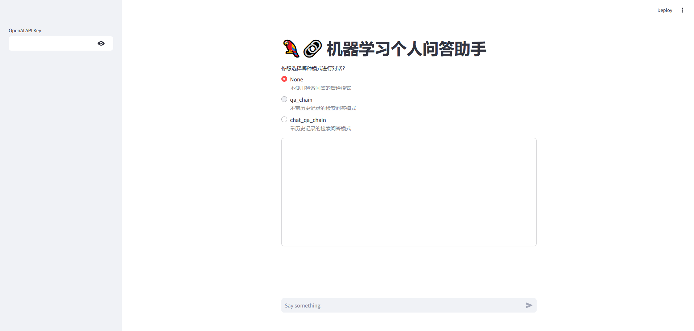

# 机器学习个人问答助手web开发
基于智谱大模型实现知识助手Web的实现

## 项目简介
该项目采用RAG（检索增强生成）技术，实现个人知识库助手web项目创建，调用智谱大模型，采用langchain的Chroma库来存储向量，采用langchain的对话chain类实现历史对话功能，使用streamlit库实现web界面的快速搭建。

## 目录结构说明

```
.
├── data_base                       # 所使用的知识库源文件
│   ├── knowledge_db                # 待向量化的知识库（pdf / md 等原始文档）
│   └── vector_db                   # 向量化后的 Chroma 持久化数据库
│       └── chroma
│           └── d06adb59-...        # 已构建好的向量集合，Web 应用直接加载此目录
├── image/web.png                   # 运行效果截图
├── streamlit_app.py                # 问答助手 web 的实现
├── requirements.txt                # 官方环境下的安装依赖
├── vectorstores_creat.py           # 向量库创建脚本
├── zhipuai_embedding.py            # 智谱向量化实现
├── zhipuai_llm.py                  # 智谱模型接口实现
└── .env                            # 环境配置（需自行创建，不要提交到仓库）
```

## 项目运行

### 1. 准备环境

建议使用 Python 3.9+ 并创建独立虚拟环境：

```bash
python -m venv .venv

# Linux / macOS
source .venv/bin/activate

# Windows
.venv\Scripts\activate
```

### 2. 安装依赖

```bash
pip install -r requirements.txt
```

### 3. 配置 API Key

在项目根目录新建 `.env` 文件，填入智谱开放平台的 API Key（可在 [BigModel 开放平台](https://open.bigmodel.cn/) 申请）：

```bash
ZHIPUAI_API_KEY=你的_API_KEY
```

> `.env` 中包含密钥，请勿提交到 Git 仓库。

### 4. （可选）重建向量库

仓库中已包含构建好的向量库，通常**无需重建**，可直接运行 Web 应用。

如果你修改了 `data_base/knowledge_db` 下的知识库文件，或需要替换为自己的文档，请重新构建向量库：

```bash
python vectorstores_creat.py
```

该脚本会遍历 `data_base/knowledge_db` 下的 `pdf` 与 `md` 文件，按 `chunk_size=500`、`chunk_overlap=50` 切分，并调用智谱 `embedding-2` 写入 `data_base/vector_db/chroma`。

重建后，请将 `streamlit_app.py` 中 `get_vectordb()` 的 `persist_directory` 更新为新的集合目录
（例如 `./data_base/vector_db/chroma/<新的集合 UUID>`）。

### 5. 启动应用

```bash
streamlit run streamlit_app.py
```

启动后浏览器会自动打开 `http://localhost:8501`。在左侧边栏填入 API Key，并选择对话模式：

| 模式 | 说明 |
| --- | --- |
| `None` | 不使用检索的普通对话模式，直接调用 GLM-4 |
| `qa_chain` | 不带历史记录的检索问答模式 |
| `chat_qa_chain` | 带历史记录的检索问答模式（推荐） |

## 项目运行结果图
<div align=center>

</div>
